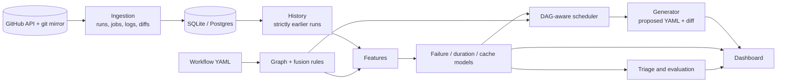

# GitHub Actions Performance Optimizer

**A dependency-graph-aware, prediction-driven analysis and scheduling toolkit for GitHub Actions CI/CD pipelines, evaluated on real workflow history.**

B.Tech CSE capstone (BCSE497J), Vellore Institute of Technology.
Akshat Singh (23BKT0005) and Aditya Choubey (23BCE2274). Supervisor: Prof. Pushpa Lakshmi R, SCOPE.

> **Status: research prototype with a deliberately critical evaluation.**
> The system ingests real GitHub Actions history, builds a heterogeneous dependency graph, predicts job failure,
> duration and cache misses, triages real failures, and proposes a re-scheduled workflow with a reviewable diff.
> It does **not** demonstrate a general speed-up. Every improvement figure it prints is labelled **ESTIMATED**
> (derived from predicted durations) or **MEASURED** (observed on recorded or executed runs), and the two are never mixed.
> Read [`docs/RESULTS.md`](docs/RESULTS.md) and [`docs/IMPROVEMENT_RESULTS.md`](docs/IMPROVEMENT_RESULTS.md) before relying on any claim.

---

## Contents

1. [What it does](#what-it-does)
2. [What the evaluation found](#what-the-evaluation-found)
3. [Architecture](#architecture)
4. [Quick start](#quick-start)
5. [The dashboard](#the-dashboard)
6. [Command reference](#command-reference)
7. [Component status](#component-status)
8. [Evaluation method](#evaluation-method)
9. [Reproducibility](#reproducibility)
10. [Repository layout](#repository-layout)
11. [Documentation](#documentation)
12. [Principles and limitations](#principles-and-limitations)

## What it does

```
Repository -> Graph -> Features -> Predictions -> Scheduler -> Proposed workflow
```

1. **Graph.** Source files, workflow jobs, steps, cache keys and `needs` edges are fused into one graph by five static rules
   (path filters, path arguments, toolchain scope, `setup-*` actions, cache-key globs). Every edge carries a provenance and a confidence.
2. **Features.** For every (run, job): does the diff reach the job, does it touch a cache key, the job's prior failure rate and
   duration, same-PR history, what the change touches (tests, dependencies, CI config, docs), author and time signals.
   History is taken strictly from runs that had **finished** before the scored run started.
3. **Models.** Three tabular models predict job failure, duration and cache misses, each measured against a naive baseline.
4. **Triage.** Real failures are classified from recorded outcomes (aggregator job, flaky on the same commit, pre-existing,
   fixed by a later commit, persistent, unrelated to the change) with the failing step and a suggested action.
5. **Scheduler.** Respects `needs`, orders jobs fail-fast, and chooses runners by `alpha*time + beta*cost + gamma*energy`.
   The default plan equals the original workflow; skip guards, larger runners and safe gate relaxation are opt-in.
6. **Generator.** Writes a **proposed** workflow, a diff and an explanation. The original file is never modified.

## What the evaluation found

All numbers come from commands in this repository run on real ingested history (nine repositories, about 4,600 runs and
72,000 (run, job) rows; see [`docs/DATASET_REPORT.md`](docs/DATASET_REPORT.md)). Intervals are paired-bootstrap 95% intervals
over runs; they are optimistic and many comparisons were made, so single cells are leads, not established effects.

| question | answer | evidence |
|---|---|---|
| Do the models beat naive baselines? | **Only in some repositories.** The default failure model (regularised logistic regression) beats the "job's prior failure rate" baseline significantly in fastapi (+0.085 PR-AUC) and in the held-out pydantic (+0.110) and is never significantly worse. The raw-seconds duration model is worse than its baseline everywhere. | [`MODEL_EVAL.md`](docs/MODEL_EVAL.md), [`HELDOUT_MODEL_EVAL.md`](docs/HELDOUT_MODEL_EVAL.md) |
| Did a richer failure model (v2) improve on that? | **Not by the standard fixed in advance.** It beat the baseline in 2 of 9 repositories (prometheus, ruff) and lost in none; the pre-registered bar was 3. A pooled model reaches 3 of 9 but was designed after seeing results, so it is only a lead; it is frozen for a fresh-data test. | [`IMPROVEMENT_PLAN.md`](docs/IMPROVEMENT_PLAN.md), [`IMPROVE_EVAL_TEST.md`](docs/IMPROVE_EVAL_TEST.md), [`POOLED_FROZEN.md`](docs/POOLED_FROZEN.md) |
| Are the failure probabilities calibrated? | **Roughly, but not better than the baseline's, and recalibration did not help.** The model's score is mildly over-confident at the top; Platt scaling and an out-of-sample isotonic map did not improve the Brier score in 3 of 4 repositories. The dashboard therefore reports what actually happened to unseen rows that scored similarly, and flags scores above anything seen out of sample. | [`CALIBRATION.md`](docs/CALIBRATION.md) |
| Does the dependency graph describe the workflow? | **Only where the workflow declares file-to-job relationships** (poetry, fastapi). On held-out workflows without file-based gating it is uninformative; where gating lives in shell scripts (ruff, uv) it points the right way only weakly. | [`GRAPH_FEATURES.md`](docs/GRAPH_FEATURES.md), [`HELDOUT_RESULTS.md`](docs/HELDOUT_RESULTS.md), [`HELDOUT_RESULTS_2.md`](docs/HELDOUT_RESULTS_2.md) |
| Does skipping jobs the graph says a diff cannot reach help? | **It saves 12-17% of billable time in two repositories but would make 3-10% (and in some held-out repositories far more) of failing runs look green, and did not generalise.** Reported as an advisory section only. | [`IMPACT_REPLAY.md`](docs/IMPACT_REPLAY.md), [`DEFERRAL_REPLAY.md`](docs/DEFERRAL_REPLAY.md) |
| Does the scheduler make CI faster? | **Not by default (0.0% estimated on real poetry).** Skip guards cannot save time under GitHub's `needs` rules; runner upsizing rests on an assumed speed-up law. | [`SCHEDULER_ASSUMPTIONS.md`](docs/SCHEDULER_ASSUMPTIONS.md) |
| Does relaxing safe `needs` gates help? | **Only on simple pipelines.** Replayed on nine repositories' history it saves about 0%. On the project's own lint -> test pipeline a real run measured the critical path **159.5 s -> 135.5 s (-15.1%, 6 vs 6 runs, p = 0.013)** with billable time +4.1% (not significant); one repository, no failing run measured. | [`GATE_REPLAY.md`](docs/GATE_REPLAY.md), [`relax_run/`](docs/relax_run) |
| Is the generated workflow safe to run? | Original vs proposed executed on real GitHub Actions (12 runs): identical behaviour, `needs` respected, no detectable time difference (+0.3%, p = 0.92). | [`VALIDITY_RUN.md`](docs/VALIDITY_RUN.md) |
| What do real CI failures look like? | In poetry and fastapi about half of all failed jobs are aggregator ("status") jobs that only repeat an upstream failure; 10-25% of red runs in four repositories needed no code change. Flakiness is under-counted (a re-run overwrites the earlier attempt). | [`FAILURE_TRIAGE.md`](docs/FAILURE_TRIAGE.md) |
| Can predictions be judged prospectively? | A hash-chained ledger scores queued runs before any job finishes. After about two days only uv has enough outcomes (46 runs, 43 failing jobs) and **neither model beat the baseline there** (old logistic significantly worse, v2 indistinguishable); a demonstration, not a significance test. The final evaluation is scheduled for 2026-10-19. | [`LIVE_TEST.md`](docs/LIVE_TEST.md) |

Removed after verification (kept in git history): a GNN that could not have worked on the current graph, and a
matrix-reduction engine whose coverage estimate overstated what it kept ([`docs/RESULTS.md`](docs/RESULTS.md) section 6).

**The credible contributions** are the evaluation method (protocol with completion-aware visibility, rolling-origin folds,
paired cluster bootstrap, pre-registered held-out repositories, prospective ledger), the negative and mixed results it
produced, the failure triage, and a working, tested pipeline that refuses to predict from too little real history.

## Architecture



`gha_optimizer/pipeline.py::run_pipeline` is the single orchestration entry point used by the CLI, the API and the tests.
The optional LLM layer (`llm_summary.py`) only words facts after every decision is made; the system works fully without it.

## Quick start

Python 3.10+. A GitHub token is needed to ingest history (job logs require authentication).

```bash
pip install -e ".[dev]"              # core pipeline, CLI and tests
pip install -e ".[server]"           # optional: API server, Celery worker, Postgres driver

export GITHUB_TOKEN=...              # or put it in .env (see .env.example)

# 1. collect real history for a repository (bounded and resumable)
gha-optimizer ingest --repo owner/repo --workflow ci.yml --since 40d --max-runs 300
gha-optimizer build-dataset --repo owner/repo        # per-commit graph features

# 2. open the dashboard on everything ingested so far
gha-optimizer dashboard --repo owner/repo            # http://localhost:8501

# 3. or analyse a workflow from the command line
gha-optimizer analyze path/to/checkout/.github/workflows/ci.yml --repo owner/repo --changed src/a.py,src/b.py
#    writes ci.optimized.yml beside it and prints the explanation, diff and ESTIMATED figures.
#    Exits 2 (declines) when the history is too thin; it never substitutes synthetic data.
```

Job logs are what give cache-miss labels. If a repository was first ingested with `--no-logs`, repeat `ingest` without it:
runs that finished without logs are revisited and their logs back-filled, newest first, within `--log-budget`.

## The dashboard

`gha-optimizer dashboard` (also served by `gha-optimizer serve` at `/dashboard`) is one page application on the ingested
repositories; there is no separate demo UI.

* **Repository selector** for every ingested repository. A repository without enough real history shows why the system declined.
* **Dashboard** with the job graph coloured by predicted failure risk, per-job duration and failure bars and an estimated timeline.
* **One page per pipeline stage** (repository, source graph, CI graph, fusion, impact, features, models, schedule, safety, workflow, summary).
* **Models and probabilities**: each failure score next to the job's own base rate and the failure rate observed on unseen rows that scored alike.
* **What-if**: pick changed files (search, one-click scenarios built from real files, or the real diff) and watch impacted jobs, predictions and the estimated plan update.
* **Original vs proposed workflow** side by side with a download button; the original is never modified.
* **Evidence**: the rows of every generated report that concern the selected repository, the project reports, and the live-test ledgers with their hash-chain status.
* **Progress** per pipeline stage, and a **disk cache** (`.gha_optimizer/dashboard_cache/`) so a restart does not repeat the work; a cached result is reused only if the ingested runs, tip commit and library versions still match.

`--warm` computes every ingested repository in the background; `--snapshot-root D:/ghas` keeps exported paths short on Windows
(apache/dubbo exceeds the 260-character limit otherwise). A presenter's guide is in [`docs/PRESENTING.md`](docs/PRESENTING.md).

## Command reference

| command | purpose |
|---|---|
| `ingest`, `ingest-status`, `build-dataset`, `dataset-report` | collect and describe real history |
| `analyze` | proposed workflow, diff and explanation (`--enable-skips`, `--larger-runners`, `--relax-gates`, `--as-of`, `--llm-summary`) |
| `dashboard`, `serve` | dashboard UI and API; full API server with webhook and worker |
| `eval-models`, `eval-pooled`, `eval-calibration` | rolling-origin model comparison, pooled model, calibration |
| `replay-impact`, `replay-gates` | counterfactual replays of the graph-skip policy and of gate relaxation on history |
| `triage` | classify real failures |
| `live-score`, `live-evaluate` | prospective scoring into a hash-chained ledger, and its evaluation |
| `evaluate` | scheduler objective-weight ablation (ESTIMATED) |
| `llm-check` | verify the optional explanation layer's credentials |

`gha-optimizer <command> --help` lists the flags. Full-stack: `docker-compose up --build` (Postgres, Redis, API, Celery worker).

## Component status

| component | status | notes |
|---|---|---|
| Ingestion of real history (runs, jobs, logs, git mirror, diffs) | IMPLEMENTED | resumable; log retention limits cache labels; log back-fill for runs ingested without logs |
| Dependency graph and fusion rules | IMPLEMENTED | static approximation; modest predictive value |
| Features with completion-aware history (protocol v2) | IMPLEMENTED | 15 extra failure features |
| Failure / duration / cache-miss models | IMPLEMENTED | mixed results against baselines; fresh-data verdicts pending |
| Persisted models (fingerprint-checked) | IMPLEMENTED | never loads a stale artifact |
| Failure triage | IMPLEMENTED | heuristics from recorded outcomes; not validated against developer actions |
| Scheduler | IMPLEMENTED | default plan = baseline; levers opt-in; figures ESTIMATED |
| Safe gate relaxation (`--relax-gates`) | IMPLEMENTED, opt-in | provably-safe gates only; validated against the original; measured once |
| Workflow generator (proposed file, diff, explanation) | IMPLEMENTED | never edits the original; never changes build matrices |
| Advisory report (graph-unreached jobs) | IMPLEMENTED | not applied automatically |
| Calibration and out-of-sample reliability | IMPLEMENTED | reporting layer; the scheduler uses the raw score |
| Dashboard (stages, what-if, evidence, progress, disk cache) | IMPLEMENTED | one UI and one service |
| Prospective live scoring | IMPLEMENTED | small samples so far |
| LLM explanation layer | IMPLEMENTED, **not verified against the live API** | cannot influence results |
| FastAPI server, Celery worker, Postgres | IMPLEMENTED (run once end to end) | [`FULL_STACK_RUN.md`](docs/FULL_STACK_RUN.md); the webhook accepts unsigned requests unless `GITHUB_WEBHOOK_SECRET` is set |
| Measured general speed-up | **NOT SHOWN** | one simple pipeline measured; mature repositories' critical paths are their test and build jobs |

## Evaluation method

* **Protocol.** A run's outcome becomes visible to later runs only after that run finished, as it would at scoring time.
* **Folds.** Expanding-window, rolling-origin; all jobs of a run are on the same side; the split is never random.
* **Baselines.** The job's prior failure rate, prior mean duration, prior cache-hit rate; metrics are always reported with the base rate.
* **Intervals.** Paired cluster bootstrap over runs (1,000 resamples, seed 13). A repository counts as a win or a loss only with at least 20 positives.
* **Pre-registration.** Choices that could be tuned were fixed in writing before the data they are judged on was read
  ([`IMPROVEMENT_PLAN.md`](docs/IMPROVEMENT_PLAN.md), [`HELDOUT_PLAN.md`](docs/HELDOUT_PLAN.md), [`FROZEN_CHOICE.md`](docs/FROZEN_CHOICE.md), [`POOLED_FROZEN.md`](docs/POOLED_FROZEN.md));
  held-out repositories were never used to choose anything.
* **Prospective test.** Predictions are written to an append-only ledger before any job of the run completes; every entry carries the hash of the previous one.

## Reproducibility

The same inputs give the same numbers. All models are seeded. The hour and weekday of the scored run are model features and
used to default to the wall clock, so the same repository scored at different hours differed; the scoring time is now an explicit
input (`as_of`: the scored run's own creation time in the dashboard and demos, `--as-of` for `analyze`). Two full dashboard
runs under different `PYTHONHASHSEED` values produced byte-identical results; `tests/test_reproducibility.py` pins the behaviour.

## Repository layout

```
gha_optimizer/
  cli.py, pipeline.py, config.py        entry points and orchestration
  ingestion/                            GitHub client, log parsing, git mirror, history loading, log back-fill
  graph/                                graph builder, fusion rules, CI semantics, workflow expansion
  features/                             feature extraction, per-commit graph features, dataset and reports
  models/                               failure / duration / cache models, rolling-origin and pooled evaluation, calibration, model store
  scheduler/, generator/, gates.py      scheduler, proposed workflow writer, safe gate relaxation
  triage.py, advisory.py, replay.py,    failure triage, advisory report, counterfactual replays
  gate_replay.py
  live.py                               prospective scoring ledger
  dashboard_service.py, dashboard_app.py, evidence.py, server/api/v1/dashboard.py     the dashboard's backend
  llm_summary.py                        optional explanation layer
  server/, worker/                      FastAPI app and database, Celery tasks
dashboard/index.html                    the single dashboard page
docs/                                   design notes, generated reports, pre-registered plans, results
tests/                                  test suite (fixtures are data, not tests)
```

## Documentation

* [`docs/RESULTS.md`](docs/RESULTS.md), [`docs/IMPROVEMENT_RESULTS.md`](docs/IMPROVEMENT_RESULTS.md) - consolidated results and threats to validity
* [`docs/REAL_DATA_FOUNDATION.md`](docs/REAL_DATA_FOUNDATION.md), [`docs/DATASET_REPORT.md`](docs/DATASET_REPORT.md) - the dataset
* [`docs/GRAPH_FEATURES.md`](docs/GRAPH_FEATURES.md) - graph rules and structural features
* [`docs/MODEL_EVAL.md`](docs/MODEL_EVAL.md), [`docs/CALIBRATION.md`](docs/CALIBRATION.md), [`docs/POOLED_EVAL.md`](docs/POOLED_EVAL.md) - model comparisons
* [`docs/FAILURE_TRIAGE.md`](docs/FAILURE_TRIAGE.md), [`docs/GATE_REPLAY.md`](docs/GATE_REPLAY.md), [`docs/LIVE_TEST.md`](docs/LIVE_TEST.md) - triage, gate relaxation, live test
* [`docs/SCHEDULER_ASSUMPTIONS.md`](docs/SCHEDULER_ASSUMPTIONS.md) - what the scheduler's estimate rests on
* [`docs/VALIDITY_RUN.md`](docs/VALIDITY_RUN.md) - original vs proposed workflow on real GitHub Actions
* [`docs/PRESENTING.md`](docs/PRESENTING.md), [`docs/VIVA_QA.md`](docs/VIVA_QA.md), [`docs/DEMO_SCRIPT.md`](docs/DEMO_SCRIPT.md) - presenting the project
* [`docs/LLM_EXPLANATION.md`](docs/LLM_EXPLANATION.md) - the optional explanation layer and its guarantees

## Principles and limitations

* No synthetic or default values are presented as results; the only synthetic generator lives in the tests.
* ESTIMATED (from predicted durations) and MEASURED (on recorded or executed runs) are never mixed.
* A generated workflow never violates a `needs` relationship that carries data or guards a side effect, and never overwrites the original file.
  The one opt-in exception, `--relax-gates`, removes only gate-only edges that can be proven safe, lists each removal and states the trade-off.
* Machine learning and scheduling do not depend on any LLM; the optional layer only words the facts.
* Claims are pre-registered where they could be tuned, and negative results are kept.

**Limitations.** Nine repositories with five to seven weeks of history each, chosen by the authors; one workflow per repository; few
failures in several repositories, so intervals are wide; cache labels exist only where logs were downloadable; the graph rules are a
static approximation; relaxed gates were measured on one repository; triage recommendations were not compared with what developers did;
the pooled failure model and the logistic default still await their fresh-data verdicts.

Licence: not yet specified.
