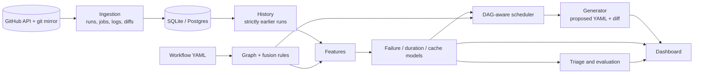

# GitHub Actions Performance Optimizer

**A dependency-graph-aware, prediction-driven analysis and scheduling toolkit for GitHub Actions CI/CD pipelines, evaluated on real workflow history.**

B.Tech CSE capstone (BCSE497J), Vellore Institute of Technology.
Akshat Singh (23BKT0005) and Aditya Choubey (23BCE2274). Supervisor: Prof. Pushpa Lakshmi R, SCOPE.

> **Status: research prototype with a deliberately critical evaluation.**
> The system ingests real GitHub Actions history, builds a heterogeneous dependency graph, predicts job failure,
> duration and cache misses, triages real failures, and proposes a re-scheduled workflow with a reviewable diff.
> It does **not** demonstrate a general speed-up. Every improvement figure it prints is labelled **ESTIMATED**
> (derived from predicted durations) or **MEASURED** (observed on recorded or executed runs), and the two are never mixed.
> Read [`docs/RESULTS.md`](docs/RESULTS.md) (section 00 is current) and [`docs/PROJECT_STATUS.md`](docs/PROJECT_STATUS.md) before relying on any claim.

---

## Contents

1. [What it does](#what-it-does)
2. [What the evaluation found](#what-the-evaluation-found)
3. [Architecture](#architecture)
4. [Quick start](#quick-start)
5. [The dashboard](#the-dashboard)
6. [Command reference](#command-reference)
7. [Component status](#component-status)
8. [Evaluation method](#evaluation-method)
9. [Reproducibility and verification](#reproducibility-and-verification)
10. [Repository layout](#repository-layout)
11. [Documentation](#documentation)
12. [Principles and limitations](#principles-and-limitations)

## What it does

```
Repository -> Graph -> Features -> Predictions -> Scheduler -> Proposed workflow
```

1. **Graph.** Source files, workflow jobs, steps, cache keys and `needs` edges are fused into one graph by five static rules
   (path filters, path arguments, toolchain scope, `setup-*` actions, cache-key globs). Every edge carries a provenance and a confidence.
2. **Features.** For every (run, job): does the diff reach the job, does it touch a cache key, the job's prior failure rate and
   duration, same-pull-request history, what the change touches (tests, dependencies, CI config, docs), author and time signals.
   History is taken strictly from runs that had **finished** before the scored run started.
3. **Models.** Three tabular models predict job failure, duration and cache misses, each measured against a naive baseline.
   When too few cache labels exist (job logs expire) the report-only cache model is shown as not applicable, never faked, and the other two still run.
4. **Triage.** Real failures are classified from recorded outcomes (aggregator job, flaky on the same commit, pre-existing,
   fixed by a later commit, persistent, unrelated to the change) with the failing step and a suggested action.
5. **Scheduler.** Respects `needs`, orders jobs fail-fast, and chooses runners by `alpha*time + beta*cost + gamma*energy`.
   The default plan equals the original workflow; skip guards, larger runners, safe gate relaxation, install pruning and pip caching are opt-in.
6. **Generator.** Writes a **proposed** workflow, a diff and an explanation. The original file is never modified.

## What the evaluation found

All numbers come from commands in this repository run on real ingested history: sixteen public repositories
(the first nine are described in [`docs/DATASET_REPORT.md`](docs/DATASET_REPORT.md); seven more were added for the failure-volume experiment). Intervals are paired-bootstrap 95% intervals
over runs; they are optimistic (runs of one pull request are correlated) and many comparisons were made, so single cells are leads, not established effects.

| question | answer | evidence |
|---|---|---|
| Do the models beat naive baselines? | **Only in some repositories.** Under the realistic protocol the boosted-tree v2 model beats the "job's prior failure rate" baseline significantly in prometheus only (+0.269 PR-AUC); the logistic default beats it nowhere and is significantly worse nowhere. The raw-seconds duration model is worse than its baseline everywhere. | [`RESULTS.md`](docs/RESULTS.md) sections 00 and 0, [`MODEL_EVAL.md`](docs/MODEL_EVAL.md) |
| Is the logistic default a sound choice? | **A safe one, not a proven gain.** Frozen in advance and tested once on runs that did not exist when it was chosen (21 Oct): not significantly worse than the baseline in all three judged repositories (poetry +0.121, prometheus +0.044, dubbo +0.057 PR-AUC, every interval includes 0). | [`FROZEN_CHOICE.md`](docs/FROZEN_CHOICE.md), [`MODEL_EVAL_FRESH_FINAL.md`](docs/MODEL_EVAL_FRESH_FINAL.md) |
| Did a richer failure model (v2) improve on it? | **Not by the standard fixed in advance:** it beat the baseline in 1 of 9 repositories; the pre-registered bar was 3. | [`IMPROVEMENT_PLAN.md`](docs/IMPROVEMENT_PLAN.md), [`IMPROVEMENT_RESULTS.md`](docs/IMPROVEMENT_RESULTS.md) |
| Do models win only where failures are plentiful? | **Inconclusive.** On six failure-rich repositories chosen by a pre-registered rule the v2 model beats the baseline in 5 and loses in none, but the criterion's second part (winners have more failures than non-winners) is not met. The largest gain (immich, PR-AUC 0.94) is mostly failure persistence within one pull request, which the baseline cannot see. | [`FAILURE_VOLUME_PLAN.md`](docs/FAILURE_VOLUME_PLAN.md), [`FAILURE_VOLUME_RESULTS.md`](docs/FAILURE_VOLUME_RESULTS.md) |
| Pooled leave-one-repository-out model, fresh-data verdict | **Rejected (26 Oct).** Frozen in advance and tested once on runs that did not exist when it was fixed: of the four repositories with at least 20 fresh failures it beats the baseline in two (prometheus +0.282, ruff +0.054 PR-AUC), is indistinguishable in two (quarkus, uv) and is worse in none; the rule needed three wins. Not adopted. One uv gap: 333 of 1,846 completed runs could not be read from GitHub (HTTP 502). | [`POOLED_FROZEN.md`](docs/POOLED_FROZEN.md), [`POOLED_EVAL_FRESH.md`](docs/POOLED_EVAL_FRESH.md) |
| Are the failure probabilities calibrated? | **No, and recalibration did not help.** The score is mildly over-confident at the top; Platt scaling and an out-of-sample isotonic map did not improve the Brier score in 3 of 4 repositories. The dashboard calls it a risk score and shows what actually happened to unseen rows that scored alike. | [`CALIBRATION.md`](docs/CALIBRATION.md) |
| Does the dependency graph describe the workflow? | **Only where the workflow declares file-to-job relationships** (poetry, fastapi). Elsewhere it is uninformative; where gating lives in shell scripts (ruff, uv) it points the right way only weakly. | [`GRAPH_FEATURES.md`](docs/GRAPH_FEATURES.md), [`HELDOUT_RESULTS.md`](docs/HELDOUT_RESULTS.md), [`HELDOUT_RESULTS_2.md`](docs/HELDOUT_RESULTS_2.md) |
| Does skipping jobs the graph says a diff cannot reach help? | **It saves 12-17% of billable time in two repositories but would make 3-10% (far more in some held-out repositories) of failing runs look green, and did not generalise.** Advisory report only. | [`IMPACT_REPLAY.md`](docs/IMPACT_REPLAY.md), [`DEFERRAL_REPLAY.md`](docs/DEFERRAL_REPLAY.md) |
| Does the scheduler make CI faster? | **Not by default (0.0% estimated on real poetry).** Skip guards cannot save time under GitHub's `needs` rules; runner upsizing rests on an assumed speed-up law. | [`SCHEDULER_ASSUMPTIONS.md`](docs/SCHEDULER_ASSUMPTIONS.md) |
| Does relaxing safe `needs` gates help? | **Where the pattern exists, with a measured price.** Real before/after runs on GitHub Actions, critical path **MEASURED**: -15.1% (our own CI, p = 0.013), -37.8% and -49.0% (two public forks), billable time unchanged in green runs. In a **failing** run the relaxed workflow still runs its downstream jobs and bills **+29 s and +97 s** more than the original, which stops after the failed gate (7 vs 7 runs each). Replayed on nine mature repositories the lever saves about 0%. Three small pipelines chosen for a large estimated saving. | [`SPEEDUP.md`](docs/SPEEDUP.md), [`SECOND_REPOSITORY.md`](docs/SECOND_REPOSITORY.md), [`GATE_REPLAY.md`](docs/GATE_REPLAY.md) |
| Install pruning, pip caching? | Install pruning: lint job 37 s -> 11 s on our own CI (critical path -19.6%, p = 0.093, not significant) and it qualifies for none of the ingested workflows. Pip caching: **no detectable effect**. | [`SPEEDUP.md`](docs/SPEEDUP.md) |
| Is the generated workflow safe to run? | Original vs proposed executed on real GitHub Actions (12 runs): identical behaviour, `needs` respected, no detectable time difference (+0.3%, p = 0.92). | [`VALIDITY_RUN.md`](docs/VALIDITY_RUN.md) |
| What do real CI failures look like? | In poetry and fastapi about half of all failed jobs are aggregator ("status") jobs that only repeat an upstream failure; 10-25% of red runs in four repositories needed no code change. Flakiness is under-counted. | [`FAILURE_TRIAGE.md`](docs/FAILURE_TRIAGE.md) |
| Can predictions be judged prospectively? | A hash-chained ledger scored queued runs before any job finished (12-22 Oct). **Neither model beat the baseline in uv (440 runs) or ruff (156 runs)**; in prometheus (76 scored runs) the v2 model did (+0.161 [+0.030, +0.320]) but only 33% of seen runs were scored, so its pre-set coverage rule failed. A demonstration, not a significance test. | [`LIVE_TEST.md`](docs/LIVE_TEST.md) |

Removed after verification (kept in git history): a GNN that could not have worked on the current graph, and a
matrix-reduction engine whose coverage estimate overstated what it kept ([`docs/RESULTS.md`](docs/RESULTS.md) section 6).

**The credible contributions** are the evaluation method (protocol with completion-aware visibility, rolling-origin folds,
paired cluster bootstrap, pre-registered tests and amendments, a prospective ledger), the negative and mixed results it
produced, the safety rules for rewriting workflows together with the measured benefit **and** cost of the one lever that removes a `needs` edge,
the failure triage, and a working, tested pipeline that refuses to predict from too little real history.
A paper draft ([`docs/paper/main.pdf`](docs/paper/main.pdf)) and the review deck ([`docs/presentation/`](docs/presentation)) present the same results.

## Architecture



`gha_optimizer/pipeline.py::run_pipeline` is the single orchestration entry point used by the CLI, the API and the tests.
The optional LLM layer (`llm_summary.py`) only words facts after every decision is made; the system works fully without it.

## Quick start

Python 3.10+. A GitHub token is needed to ingest history (job logs require authentication).

```bash
pip install -e ".[dev]"              # core pipeline, CLI and tests
pip install -e ".[server]"           # optional: API server, Celery worker, Postgres driver

export GITHUB_TOKEN=...              # or put it in .env (see .env.example)

# 1. collect real history for a repository (bounded and resumable)
gha-optimizer ingest --repo owner/repo --workflow ci.yml --since 40d --max-runs 300
gha-optimizer build-dataset --repo owner/repo        # per-commit graph features

# 2. open the dashboard on everything ingested so far
gha-optimizer dashboard --repo owner/repo            # http://localhost:8501

# 3. or analyse a workflow from the command line
gha-optimizer analyze path/to/checkout/.github/workflows/ci.yml --repo owner/repo --changed src/a.py,src/b.py
#    writes ci.optimized.yml beside it and prints the explanation, diff and ESTIMATED figures.
#    Exits 2 (declines) when the history is too thin; it never substitutes synthetic data.
```

**`.env`:** copy `.env.example` to `.env` (git ignores it). For local use leave `DATABASE_URL` commented out so the SQLite database
`gha_optimizer.db` is used; the Postgres URL in the template is for the compose stack, which sets its own. Never put a key in `.env.example`.

**Optional explanation layer:** set `GEMINI_API_KEY` and `GHA_LLM_MODEL` (no model name is assumed: copy a current id from Google AI Studio) in `.env`,
check with `gha-optimizer llm-check`, then add `--llm-summary` to `analyze`. The summary is checked by the application (every number must be a
rounding or magnitude of a computed fact) and cannot change the plan or the proposed file.

Job logs are what give cache-miss labels. If a repository was first ingested with `--no-logs`, repeat `ingest` without it:
runs that finished without logs are revisited and their logs back-filled, newest first, within `--log-budget`.

## The dashboard

`gha-optimizer dashboard` (also served by `gha-optimizer serve` at `/dashboard`) is one page application on the ingested
repositories; there is no separate demo UI. The page ships inside the package (`gha_optimizer/dashboard_ui/index.html`), so an installed copy serves it too.

* **Repository selector** for every ingested repository. A repository without enough real history (or without failure labels) shows why the system declined.
* **Dashboard** with the job graph coloured by predicted failure risk, per-job duration and failure bars and an estimated timeline.
* **One page per pipeline stage** (repository, source graph, CI graph, fusion, impact, features, models, schedule, safety, workflow, summary).
* **Models and probabilities**: each failure score next to the job's own base rate and the failure rate observed on unseen rows that scored alike.
* **What-if**: pick changed files (search, one-click scenarios built from real files, or the real diff) and watch impacted jobs, predictions and the estimated plan update.
* **Original vs proposed workflow** side by side with a download button; the original is never modified.
* **Evidence**: the rows of every generated report that concern the selected repository, the project reports, and the live-test ledgers with their hash-chain status.
* **Progress** per pipeline stage, and a **disk cache** (`.gha_optimizer/dashboard_cache/`) so a restart does not repeat the work; a cached result is reused only if the ingested runs, tip commit and library versions still match.

`--warm` computes every ingested repository in the background (about 20 minutes for nineteen); `--snapshot-root D:/ghas` keeps exported paths short on Windows
(apache/dubbo exceeds the 260-character limit otherwise). A presenter's guide is in [`docs/PRESENTING.md`](docs/PRESENTING.md), the demo script in [`docs/DEMO_SCRIPT.md`](docs/DEMO_SCRIPT.md).

## Command reference

| command | purpose |
|---|---|
| `ingest`, `ingest-status`, `build-dataset`, `dataset-report` | collect and describe real history |
| `analyze` | proposed workflow, diff and explanation (`--enable-skips`, `--larger-runners`, `--relax-gates`, `--prune-installs`, `--add-pip-cache`, `--as-of`, `--llm-summary`) |
| `dashboard`, `serve` | dashboard UI and API; full API server with webhook and worker |
| `eval-models`, `eval-pooled`, `eval-calibration` | rolling-origin model comparison, pooled model, calibration |
| `replay-impact`, `replay-gates` | counterfactual replays of the graph-skip policy and of gate relaxation on history |
| `triage` | classify real failures |
| `live-score`, `live-evaluate` | prospective scoring into a hash-chained ledger, and its evaluation (outcomes only: no diff, one setup) |
| `evaluate` | scheduler objective-weight ablation (ESTIMATED) |
| `llm-check` | verify the optional explanation layer's credentials with one tiny request (no repository data) |
| `python scripts/measure_workflows.py` | **real** before/after (or, with `--inject-failure`, failing-run) measurement of two workflow files on GitHub Actions via throw-away draft pull requests |

`gha-optimizer <command> --help` lists the flags. Full-stack: `docker-compose up --build` (Postgres, Redis, API, Celery worker).

## Component status

Classification: IMPLEMENTED (code exists, reachable from an entry point, run, tested), PARTIALLY IMPLEMENTED, STUB, PLANNED, REMOVED.
The full table with what was verified for each component is [`docs/PROJECT_STATUS.md`](docs/PROJECT_STATUS.md).

| component | status | notes |
|---|---|---|
| Ingestion of real history (runs, jobs, logs, git mirror, diffs) | IMPLEMENTED | resumable; waits out network outages; log retention limits cache labels |
| Dependency graph and fusion rules | IMPLEMENTED | static approximation; modest predictive value |
| Features with completion-aware history (protocol v2) | IMPLEMENTED | 15 extra failure features |
| Failure / duration / cache-miss models | IMPLEMENTED | mixed results against baselines; default confirmed as a safe choice |
| Persisted models (fingerprint-checked) | IMPLEMENTED | never loads a stale artifact |
| Failure triage | IMPLEMENTED | heuristics from recorded outcomes; not validated against developer actions |
| Scheduler | IMPLEMENTED | default plan = baseline; levers opt-in; figures ESTIMATED |
| Safe gate relaxation (`--relax-gates`) | IMPLEMENTED, opt-in | provably-safe gates only; validated against the original; **measured** saving and measured failing-run cost on three / two pipelines |
| Install pruning, pip caching | IMPLEMENTED, opt-in | pruning measured once (not significant); pip caching shows no detectable effect |
| Workflow generator (proposed file, diff, explanation) | IMPLEMENTED | never edits the original; never changes build matrices |
| Advisory report (graph-unreached jobs) | IMPLEMENTED | not applied automatically |
| Calibration and out-of-sample reliability | IMPLEMENTED | reporting layer; the scheduler uses the raw score |
| Dashboard (stages, what-if, evidence, progress, disk cache) | IMPLEMENTED | one UI and one service; ships inside the package |
| Prospective live scoring | IMPLEMENTED | ran 12-22 Oct with gaps; outcomes of all scored runs read |
| LLM explanation layer | IMPLEMENTED, verified against the live Gemini API (26 Oct) | cannot influence results; output identical with and without it |
| FastAPI server, Celery worker, Postgres | IMPLEMENTED (run end to end 11 Oct and 26 Oct) | [`FULL_STACK_RUN.md`](docs/FULL_STACK_RUN.md); the webhook accepts unsigned requests unless `GITHUB_WEBHOOK_SECRET` is set |
| Packaging | IMPLEMENTED | a clean non-editable install in `python:3.10-slim` runs the test suite; not verified on a fresh Windows virtualenv (Smart App Control blocks scikit-learn there) |
| Measured general speed-up | **NOT SHOWN** | gains on three simple pipelines chosen for a large estimated saving; mature repositories' critical paths are their test and build jobs |
| GNN cache predictor, matrix reduction | **REMOVED** | verified unworkable / overstated; see `docs/RESULTS.md` |

## Evaluation method

* **Protocol.** A run's outcome becomes visible to later runs only after that run finished, as it would at scoring time.
* **Folds.** Expanding-window, rolling-origin; all jobs of a run are on the same side; the split is never random.
* **Baselines.** The job's prior failure rate, prior mean duration, prior cache-hit rate; metrics are always reported with the base rate.
* **Intervals.** Paired cluster bootstrap over runs (1,000 resamples, seed 13). A repository counts as a win or a loss only with at least 20 positives.
* **Pre-registration.** Choices that could be tuned were fixed in writing before the data they are judged on was read, and later changes are dated amendments made before the stage they concern
  ([`IMPROVEMENT_PLAN.md`](docs/IMPROVEMENT_PLAN.md), [`HELDOUT_PLAN.md`](docs/HELDOUT_PLAN.md), [`FROZEN_CHOICE.md`](docs/FROZEN_CHOICE.md), [`FAILURE_VOLUME_PLAN.md`](docs/FAILURE_VOLUME_PLAN.md), [`POOLED_FROZEN.md`](docs/POOLED_FROZEN.md));
  held-out repositories were never used to choose anything.
* **Measured speed-ups** run the original and proposed workflow alternately on real GitHub Actions runners (warm-up excluded, exact permutation test on the difference of medians); every percentage in the documents was recomputed from the raw timing files.
* **Prospective test.** Predictions are written to an append-only ledger before any job of the run completes; every entry carries the hash of the previous one.

## Reproducibility and verification

The same inputs give the same numbers. All models are seeded. The hour and weekday of the scored run are model features and
used to default to the wall clock, so the same repository scored at different hours differed; the scoring time is now an explicit
input (`as_of`: the scored run's own creation time in the dashboard and demos, `--as-of` for `analyze`). Two full dashboard
runs under different `PYTHONHASHSEED` values produced byte-identical results; `tests/test_reproducibility.py` pins the behaviour.

Verified on 2026-10-26: **479 tests pass** (1 skipped); `ruff` and `mypy gha_optimizer/ --ignore-missing-imports` are clean (`mypy.ini` documents one remaining gap: SQLAlchemy's typing of legacy `Column` attributes in the modules that touch ORM attributes);
the suite also passes against a clean non-editable install in a Python 3.10 container (which found and led to the fix of three defects hidden by editable installs); the `docker compose` stack was run end to end.

## Repository layout

```
gha_optimizer/
  cli.py, pipeline.py, config.py        entry points and orchestration
  ingestion/                            GitHub client, log parsing, git mirror, history loading, log back-fill
  graph/                                graph builder, fusion rules, CI semantics, workflow expansion
  features/                             feature extraction, per-commit graph features, dataset and reports
  models/                               failure / duration / cache models, rolling-origin and pooled evaluation, calibration, model store
  scheduler/, generator/                scheduler, proposed workflow writer
  gates.py, install_pruning.py,         opt-in levers and their validation
  pip_cache.py
  triage.py, advisory.py, replay.py,    failure triage, advisory report, counterfactual replays
  gate_replay.py
  live.py                               prospective scoring ledger
  dashboard_service.py, dashboard_app.py, evidence.py, server/api/v1/dashboard.py     the dashboard's backend
  dashboard_ui/index.html               the single dashboard page (package data)
  llm_summary.py                        optional explanation layer
  server/, worker/                      FastAPI app and database, Celery tasks
scripts/                                measurement harness, live-test runner, demo launchers
docs/                                   design notes, generated reports, pre-registered plans, results, paper, deck
tests/                                  test suite (fixtures are data, not tests)
```

## Documentation

* [`docs/PROJECT_STATUS.md`](docs/PROJECT_STATUS.md) - status of every component, what is verified and what is left
* [`docs/RESULTS.md`](docs/RESULTS.md), [`docs/IMPROVEMENT_RESULTS.md`](docs/IMPROVEMENT_RESULTS.md), [`docs/FAILURE_VOLUME_RESULTS.md`](docs/FAILURE_VOLUME_RESULTS.md) - consolidated results and threats to validity
* [`docs/REAL_DATA_FOUNDATION.md`](docs/REAL_DATA_FOUNDATION.md), [`docs/DATASET_REPORT.md`](docs/DATASET_REPORT.md) - the dataset
* [`docs/GRAPH_FEATURES.md`](docs/GRAPH_FEATURES.md) - graph rules and structural features
* [`docs/MODEL_EVAL.md`](docs/MODEL_EVAL.md), [`docs/CALIBRATION.md`](docs/CALIBRATION.md), [`docs/POOLED_EVAL.md`](docs/POOLED_EVAL.md) - model comparisons
* [`docs/SPEEDUP.md`](docs/SPEEDUP.md), [`docs/SECOND_REPOSITORY.md`](docs/SECOND_REPOSITORY.md), [`docs/GATE_REPLAY.md`](docs/GATE_REPLAY.md) - the speed-up levers, measured and replayed
* [`docs/FAILURE_TRIAGE.md`](docs/FAILURE_TRIAGE.md), [`docs/LIVE_TEST.md`](docs/LIVE_TEST.md) - triage and the live test
* [`docs/SCHEDULER_ASSUMPTIONS.md`](docs/SCHEDULER_ASSUMPTIONS.md) - what the scheduler's estimate rests on
* [`docs/VALIDITY_RUN.md`](docs/VALIDITY_RUN.md), [`docs/FULL_STACK_RUN.md`](docs/FULL_STACK_RUN.md) - original vs proposed workflow on real GitHub Actions; the full stack
* [`docs/PRESENTING.md`](docs/PRESENTING.md), [`docs/VIVA_QA.md`](docs/VIVA_QA.md), [`docs/DEMO_SCRIPT.md`](docs/DEMO_SCRIPT.md), [`docs/paper/`](docs/paper), [`docs/presentation/`](docs/presentation) - presenting the project
* [`docs/LLM_EXPLANATION.md`](docs/LLM_EXPLANATION.md) - the optional explanation layer, its guarantees and its live verification

## Principles and limitations

* No synthetic or default values are presented as results; the only synthetic generator lives in the tests.
* ESTIMATED (from predicted durations) and MEASURED (on recorded or executed runs) are never mixed.
* A generated workflow never violates a `needs` relationship that carries data or guards a side effect, and never overwrites the original file.
  The one opt-in exception, `--relax-gates`, removes only gate-only edges that can be proven safe, lists each removal and states the trade-off (now also measured).
* Machine learning and scheduling do not depend on any LLM; the optional layer only words the facts.
* Claims are pre-registered where they could be tuned, and negative results are kept.

**Limitations.** Sixteen repositories with weeks to months of history each, chosen by the authors or by a written rule (the seven failure-volume repositories because they fail often); one workflow per repository; few
failures in several repositories, so intervals are wide and optimistic; cache labels exist only where logs were downloadable; the graph rules are a static approximation; the speed-up is shown on three small pipelines
chosen for a large estimated saving and its failing-run cost on two of them; the live test has gaps and 33 uv runs could not be read; triage recommendations were not compared with what developers did;
the optional explanation layer was verified on one repository and one model.

Licence: not yet specified.
